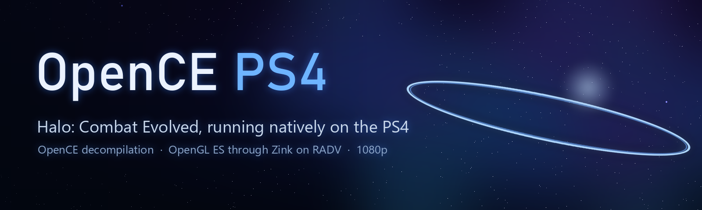

  

  
  
  
  

<h3 align="center">Halo: Combat Evolved, native on the PS4.</h3>

  <a href="#getting-started"><b>Getting started</b></a> ·
  <a href="#controls">Controls</a> ·
  <a href="#status">Status</a> ·
  <a href="FAQ.md">FAQ</a> ·
  <a href="docs/BUILDING.md">Building</a> ·
  <a href="CREDITS.md">Credits</a>

---

## Overview

OpenCE PS4 brings [OpenCE](https://github.com/OpenCommunityEdition/OpenCE), the open source port of
the **Halo: Combat Evolved** decompilation, to jailbroken PS4 consoles as an app you launch from the
home screen like any other. It isn't an emulator: the game's own code, rebuilt from source, runs
directly on the PS4's CPU, and its renderer draws through OpenGL ES on the PS4's GPU at 1080p.

Under the hood, the game runs as a 32-bit-pointer (**x32**) program inside the PS4 app, the same
way OpenCE's Android port runs it, because Halo's map files are full of 32-bit pointers. OpenGL ES
is Mesa's **Zink** (OpenGL on Vulkan) on top of **RADV**, Mesa's Vulkan driver adapted to submit
work directly to the PS4's AMD GPU.

You bring your own copy of the game. Nothing copyrighted is in this repository: no maps, no game
files, no Microsoft or Sony files.

## Highlights

**The whole game, natively**
- The original Xbox campaign, from your own maps, rebuilt from OpenCE's decompiled source. The
  game logic isn't emulated, so it runs at full speed on the PS4's CPU.
- 1080p through OpenCE's OpenGL ES renderer, the same one OpenCE's Android version uses.
- Menus, loading, cutscenes, sound and saving all work.

**Made for the PS4's hardware**
- Six CPU cores in use: the game on one, and Mesa preparing the graphics work on others
  (Gallium's threaded context and glthread).
- Shaders are compiled once and kept in `/data/OpenCE/mesa`, so they don't cause hitches the next
  time.
- Checkpoints are written to disk in the background, so saving doesn't pause the game.
- Three swapchain images and two frames in flight smooth out the odd slow frame.
- The game is built with the profile-guided optimisation profile OpenCE ships for its Linux build.

**The DualShock 4 as an Xbox controller**
- The buttons sit where the Xbox controller's are (see [Controls](#controls)).
- Every player signed in on the console gets their own controller, up to four.

**One package**
- The build script can put your maps inside the package, so you install one file and play. You
  can also copy the maps over FTP, or let the game pull them from your Xbox disc image.
- The home screen icon and background are made from your own copy's Halo logo when you build.

**When something goes wrong**
- Logs, crash reports, and a log line for every slow frame and every
  slow file operation, so reports show what caused a hitch.

## Getting started

**You need:** a jailbroken PS4 with **GoldHEN** (developed on a launch-model PS4), an FTP connection
to it, and your own copy of **Halo: Combat Evolved** for the original Xbox.

No package is published: a package can't be shared once it holds the maps, so you build your own
(see [Building](docs/BUILDING.md)). Then:

1. Install **`OpenCE-vXX.YY.pkg`** with GoldHEN's **Package Installer**.
2. If your package doesn't have the maps inside, give the game its maps in one of these ways:
   - copy the `maps` folder of your game (the 24 `.map` files, about 1.8 GB) to
     **`/data/OpenCE/maps/`** over FTP, or
   - put your Xbox disc image (`.iso` or `.xiso`) in **`/data/OpenCE/`**. At the first start the
     game extracts the maps from it; you can delete the image afterwards.
3. Start **Halo: Combat Evolved** from the home screen.

> **Tip:** the maps of the retail Xbox release (NTSC 1.0, build 01.10.12.2276) are the ones tested.
> An extracted Xbox game folder has the `maps` folder as it is.

**Updating:** install the newer package on top of the old one. Your saves and settings live in
`/data/OpenCE/` and carry over.

## Controls

The DualShock 4's buttons are the Xbox controller's at the same places, so the game's own controls
(and its control settings) apply as they would on an Xbox.

| DualShock 4 | Xbox controller |
|---|---|
| Cross | A |
| Circle | B |
| Square | X |
| Triangle | Y |
| L1 / R1 | White / Black |
| L2 / R2 | Left / right trigger |
| OPTIONS | Start |
| Touchpad click | Back |
| Left / right stick | Left / right stick |
| L3 / R3 | Stick buttons |
| D-pad | D-pad |

## Status

| Status | Meaning |
|---|---|
|  | Runs well enough to play through |
|  | Gets into the game, but slowdowns, glitches or freezes get in the way |
|  | Doesn't start, or closes right away |

**Tested by us** on a launch-model PS4, frames per second while playing:

| Status | What | FPS |
|---|---|---|
|  | Campaign: *The Pillar of Autumn* (cryo, training, first fights) | 55–60, dips to 44–51 in busy fights. v00.03 hitched at checkpoints and in busy scenes; v00.04 targets those hitches and is waiting for a test. |
|  | Menus, loading, cutscenes, sound, saving | Smooth |

Played further, or tried split screen? [Open an issue](https://github.com/iHaiDeeZ/OpenCE-PS4/issues)
with the level, the version, your console and firmware, and how it ran.

## Your files

Everything the app creates sits in **`/data/OpenCE/`**:

- `maps/`: the game's maps, if they aren't inside your package
- `save/`: saved games and profiles
- `config.toml`: the game's settings
- `mesa/`: the shader cache
- `env.txt`: optional `NAME=value` lines read at start, for testing Mesa options
  (`mesa_glthread=false`, `GALLIUM_THREAD=0`, `ZINK_DEBUG=...`)
- `opence.log`: the PS4 side's log, with `hitch:` lines for frames of 50 ms and more and `slow:`
  lines for file operations of 30 ms and more
- `debug.txt`: the game's own log
- `boot-trace.log`, `crash.log`, `mesa.log`: start-up trace, crash reports, Mesa's messages

## FAQ

The full list is in **[FAQ.md](FAQ.md)**. The most common questions:

**Where do I get the package?**
You build it from this repository with your own copy of the game: a package with the maps inside
is yours alone and must never be shared. See [Building](docs/BUILDING.md).

**It hitches the first time I play a level.**
New shaders are compiled the first time they're needed. They're kept, so the next time is
smoother. If a level keeps hitching, send `opence.log`: its `hitch:` and `slow:` lines show why.

**The game says it can't find its maps.**
Check `/data/OpenCE/maps/` holds the 24 `.map` files (`ui.map`, `a10.map`, ...), not a folder
inside a folder.

**How do I report a bug?**
[Open an issue](https://github.com/iHaiDeeZ/OpenCE-PS4/issues). Attach `opence.log`,
`boot-trace.log`, `debug.txt` and, if there is one, `crash.log` from `/data/OpenCE/`, and mention
the version, where in the game it happened, your PS4 model and firmware.

## Good to know

- The tested maps are the original Xbox version's (OpenCE is built for them).
- Save in the game: there are no save states. Your saves are in `/data/OpenCE/save` and carry over
  to new versions.
- Online and LAN play haven't been tried yet.
- Only the original PS4 has been tested so far. PS4 Pro reports are welcome.

## Thanks

- **[OpenCE](https://github.com/OpenCommunityEdition/OpenCE)** and everyone who decompiled Halo:
  Combat Evolved and ported it to Windows, Linux and Android: this port is their work running on
  one more machine
- **[Mesa](https://mesa3d.org)**: Zink and the RADV Vulkan driver that draw every frame
- **[OpenOrbis](https://github.com/OpenOrbis)**: the PS4 toolchain
- **[musl](https://musl.libc.org)**: the C library inside the game
- **[LLVM](https://llvm.org)**: clang and lld, which build both halves
- **[love-ps4](https://github.com/Mari0/love-ps4)**: the reference PS4 setup

Everyone involved, with licences, is listed in **[CREDITS.md](CREDITS.md)**.

## License and disclaimer

Released under the **GNU Affero General Public License v3.0 or later**, the same licence as OpenCE.
See [LICENSE](LICENSE). The PS4 runtime and toolchain come from the author's
[SMW](https://github.com/iHaiDeeZ/SMW) and [Crema](https://github.com/iHaiDeeZ/Crema) ports.

This is a fan-made project with no ties to Microsoft, Xbox Game Studios, Bungie, Halo Studios,
Sony Interactive Entertainment or the OpenCE project. Halo and Xbox are trademarks of Microsoft;
PlayStation and PS4 are trademarks of Sony Interactive Entertainment. Please only play games you
own. This project won't help you find or share game files.
